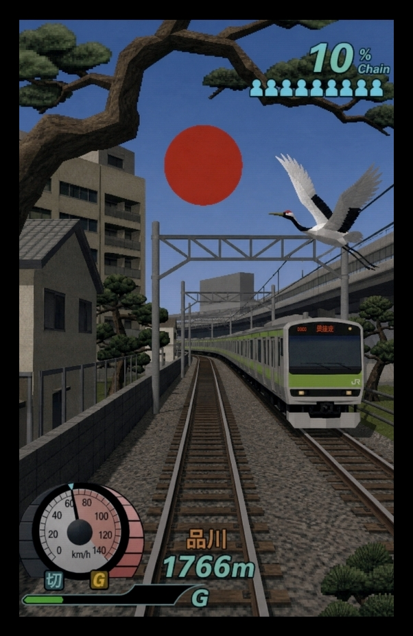
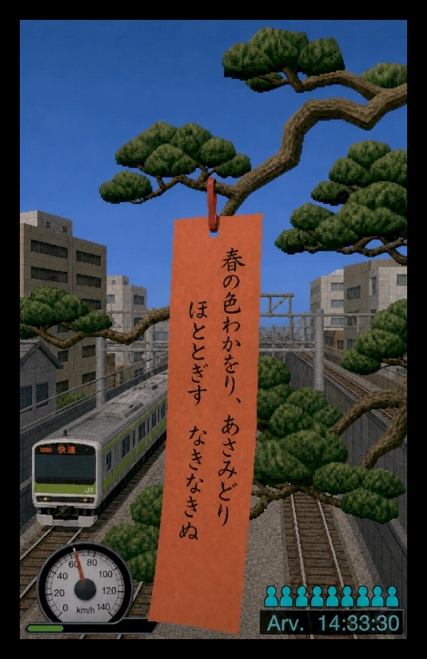
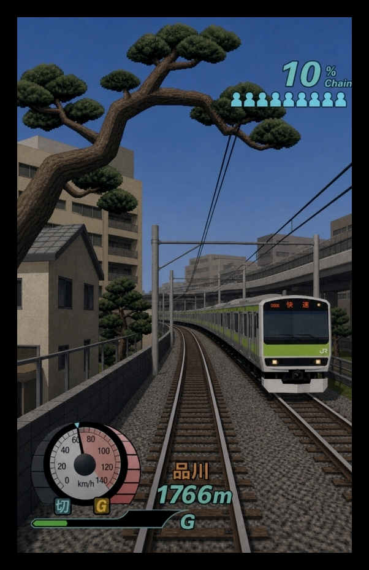
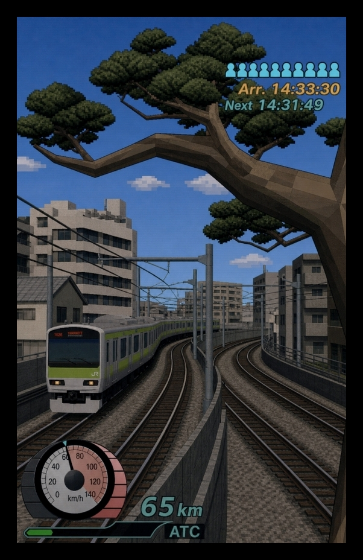

# DenshaDeKoi – Card Gallery

All 48 custom railway-themed Hanafuda cards in original resolution (`602×928 px`).

| Month | Card 1 | Card 2 | Card 3 | Card 4 |
| :--- | :---: | :---: | :---: | :---: |
| **01 – January** Pine *(Matsu)* |  `01-B` · Bright |  `01-RP` · Red poem ribbon |  `01-P1` · Chaff 1 |  `01-P2` · Chaff 2 |
| **02 – February** Plum Blossom *(Ume)* |  `02-A` · Animal |  `02-RP` · Red poem ribbon |  `02-P1` · Chaff 1 |  `02-P2` · Chaff 2 |
| **03 – March** Cherry Blossom *(Sakura)* |  `03-B` · Bright |  `03-RP` · Red poem ribbon |  `03-P1` · Chaff 1 |  `03-P2` · Chaff 2 |
| **04 – April** Wisteria *(Fuji)* |  `04-A` · Animal |  `04-R` · Red ribbon |  `04-P1` · Chaff 1 |  `04-P2` · Chaff 2 |
| **05 – May** Iris *(Ayame)* |  `05-A` · Animal |  `05-R` · Red ribbon |  `05-P1` · Chaff 1 |  `05-P2` · Chaff 2 |
| **06 – June** Peony *(Botan)* |  `06-A` · Animal |  `06-RB` · Blue ribbon |  `06-P1` · Chaff 1 |  `06-P2` · Chaff 2 |
| **07 – July** Bush Clover *(Hagi)* |  `07-A` · Animal |  `07-R` · Red ribbon |  `07-P1` · Chaff 1 |  `07-P2` · Chaff 2 |
| **08 – August** Susuki Grass *(Susuki)* |  `08-B` · Bright |  `08-A` · Animal |  `08-P1` · Chaff 1 |  `08-P2` · Chaff 2 |
| **09 – September** Chrysanthemum *(Kiku)* |  `09-A` · Animal |  `09-RB` · Blue ribbon |  `09-P1` · Chaff 1 |  `09-P2` · Chaff 2 |
| **10 – October** Maple *(Momiji)* |  `10-A` · Animal |  `10-RB` · Blue ribbon |  `10-P1` · Chaff 1 |  `10-P2` · Chaff 2 |
| **11 – November** Willow *(Yanagi)* |  `11-B` · Bright |  `11-A` · Animal |  `11-R` · Red ribbon |  `11-P1` · Chaff 1 |
| **12 – December** Paulownia *(Kiri)* |  `12-B` · Bright |  `12-P1` · Chaff 1 |  `12-P2` · Chaff 2 |  `12-P3` · Chaff 3 |
